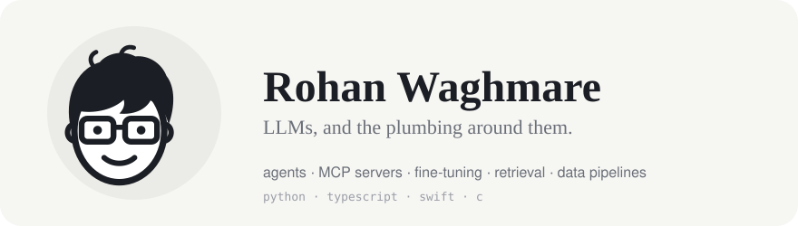

<picture>
  <source media="(prefers-color-scheme: dark)" srcset="assets/banner-dark.svg" />
  
</picture>

Software engineer working on LLM systems: agents, MCP servers, fine-tuning pipelines and retrieval. Mostly Python, some TypeScript, a little Swift and C.

### Building lately

- **[Agentic-Tool-Orchestrator](https://github.com/ron103/Agentic-Tool-Orchestrator)** · Python, FastAPI, OpenAI 
  A two-stage agent over 191 tools in 7 services. A small router picks the services, the tool loop only sees those tools, and an escape hatch loads more mid-run. Turn, call and time budgets, a repeat-failure breaker, and a 24-test suite.
- **[imdb-mcp](https://github.com/ron103/imdb-mcp)** · Python, MCP 
  A cloud-runnable MCP server that exposes IMDB data to LLMs over JSON-RPC.
- **[claude-polymarket-bot](https://github.com/ron103/claude-polymarket-bot)** · Python, Claude API, SQLite 
  An hourly agent for Kalshi markets: scans six series, has Claude research the top ten with web search, and paper-bets only above 65% confidence.
- **[nutrition-tracking-notion-ai-chatbot](https://github.com/ron103/nutrition-tracking-notion-ai-chatbot)** · Python, Claude Vision, Notion 
  A Telegram bot that turns meal photos, text or barcodes into macros, with Notion as the database.
- **[rohanwaghmarev3](https://github.com/ron103/rohanwaghmarev3)** · TypeScript, Next.js 16, React 19, Tailwind v4 
  My portfolio, with runnable pipeline diagrams and trace replays built from scratch.

### Earlier builds

- **[industry-specific-layoff-tracker](https://github.com/ron103/industry-specific-layoff-tracker)** · Python, Faktory, MongoDB, Flask 
  Reddit and 4chan crawlers feeding queued workers that score toxicity and sentiment, 200k+ posts a month, with an hourly monitor and day-by-day backfill.
- **[clockin](https://github.com/ron103/clockin)** · Swift, SwiftUI, WatchKit 
  Shift tracking for iPhone and Apple Watch on one shared MVVM layer.
- **[onymos-stock-trader](https://github.com/ron103/onymos-stock-trader)** · Python 
  An order book for 1,024 tickers with threaded order matching.
- **[File-Sharing-System](https://github.com/ron103/File-Sharing-System)** · C 
  A multi-client file server: upload, download, list and delete.
- **[Detection-of-Tuberculosis-using-Transfer-Learning](https://github.com/ron103/Detection-of-Tuberculosis-using-Transfer-Learning)** · TensorFlow, ResNet-50 
  CLAHE preprocessing and transfer learning on TBX11K. [Published at IEEE.](https://ieeexplore.ieee.org/document/10112352)

### Toolbox

- **Languages:** Python, TypeScript, Swift, C, SQL
- **LLMs:** PyTorch, vLLM, QLoRA, LangGraph, MCP, Claude and OpenAI APIs
- **Infra:** Docker, Kubernetes, ArgoCD, Terraform, AWS, GCP
- **Data:** PostgreSQL, MongoDB, Neo4j, SPARQL, ClickHouse

---

The non-code side of me lives at <a href="https://rohanwaghmare.com">rohanwaghmare.com</a> · <a href="https://linkedin.com/in/rohanwaghmare">LinkedIn</a> · <a href="mailto:waghmarerohan30@gmail.com">email</a>
